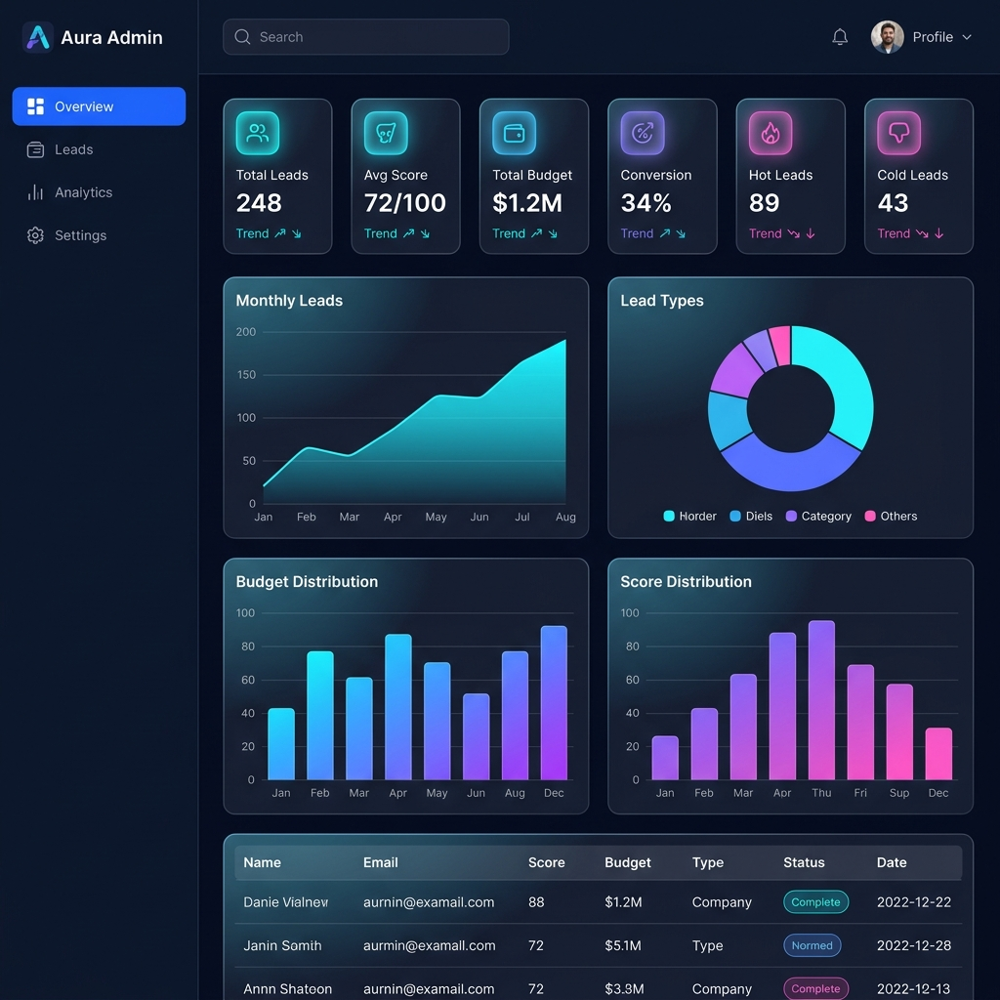
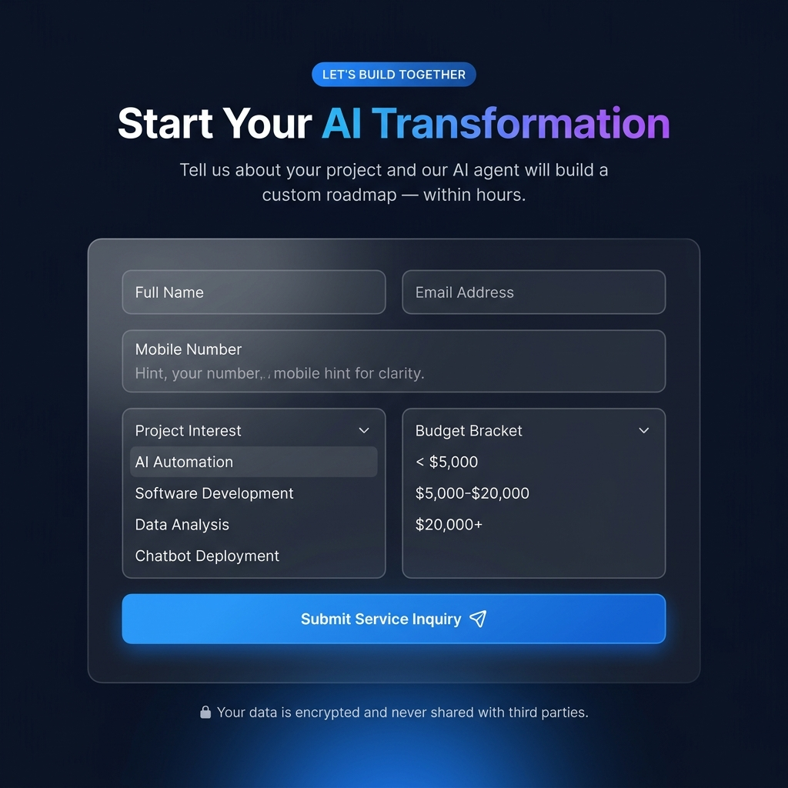
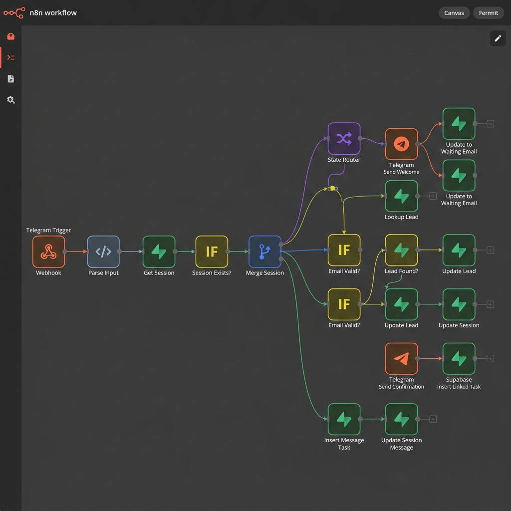

<](https://react.dev/)
[](https://vitejs.dev/)
[](https://supabase.com/)
[](https://n8n.io/)
[](https://tailwindcss.com/)
[](https://recharts.org/)

</div>

---

## 📋 Table of Contents

- [Overview](#-overview)
- [Screenshots](#-screenshots)
- [Architecture](#-architecture)
- [Tech Stack](#-tech-stack)
- [Project Structure](#-project-structure)
- [How It Works](#-how-it-works)
- [Getting Started](#-getting-started)
- [Environment Variables](#-environment-variables)
- [N8N Workflow](#-n8n-workflow)
- [License](#-license)

---

## 🌟 Overview

**Aura Automation** is a production-grade, full-stack AI lead automation platform built for modern B2B businesses. It captures inbound leads from a polished marketing website, routes them through an intelligent n8n automation pipeline, scores them using AI, and surfaces actionable analytics in a real-time admin dashboard — all with zero manual intervention.

### Key Capabilities

| Feature | Description |
|---|---|
| 🎯 **Lead Capture** | Animated landing page with validated multi-field inquiry form |
| 🤖 **AI Scoring** | GPT-4 powered lead qualification across 12+ intent dimensions |
| 📱 **Telegram Bot** | Automated account linking & real-time Telegram notifications |
| 📊 **Analytics Dashboard** | Live charts, stat cards, and leads table powered by Supabase |
| ⚡ **n8n Orchestration** | End-to-end stateful workflow with session management |
| 🔒 **Secure by Default** | `.env`-based secrets, Supabase RLS, and encrypted data transit |

---

## 📸 Screenshots

### 🌐 User Landing Page — Hero Section


---

### 📊 Admin Analytics Dashboard


---

### 📬 Lead Inquiry Form


---

### ⚙️ N8N Automation Workflow


---

## 🏗️ Architecture

```
┌─────────────────────────────────────────────────────────────────┐
│                        USER JOURNEY                              │
│                                                                  │
│  [User Landing Page]  ──(form submit)──▶  [n8n Webhook]         │
│    React + Tailwind                         │                    │
│                                             ▼                    │
│                                    [AI Lead Scoring]             │
│                                    GPT-4 Qualification           │
│                                             │                    │
│                                             ▼                    │
│                                    [Supabase Database]           │
│                                    leads / telegram_sessions     │
│                                    agent_tasks tables            │
│                                             │                    │
│                          ┌──────────────────┼─────────────────┐  │
│                          ▼                  ▼                 ▼  │
│                   [Email Follow-up]  [Telegram Bot]  [Admin Dashboard] │
│                   Automated drip     Account linking  Real-time analytics │
│                   sequences          & notifications   React + Recharts  │
└─────────────────────────────────────────────────────────────────┘
```

### Supabase Schema

| Table | Purpose |
|---|---|
| `leads` | Stores all captured lead records with scoring data |
| `telegram_sessions` | Manages Telegram bot conversation state per user |
| `agent_tasks` | Task queue for async AI agent processing |

---

## 🛠️ Tech Stack

### User Frontend (`/user`)
| Technology | Version | Purpose |
|---|---|---|
| React | 19 | UI framework |
| Vite | 8 | Build tooling |
| Tailwind CSS | 4 | Utility-first styling |
| Framer Motion | 12 | Animations & transitions |
| Lucide React | Latest | Icon library |

### Admin Dashboard (`/Admin`)
| Technology | Version | Purpose |
|---|---|---|
| React | 19 | UI framework |
| Vite | 8 | Build tooling |
| Tailwind CSS | 4 | Utility-first styling |
| Recharts | 3 | Data visualisation |
| Supabase JS | 2 | Database client |

### Backend / Automation (`/N8N`)
| Technology | Purpose |
|---|---|
| n8n | Visual workflow orchestration |
| Supabase | PostgreSQL database + realtime |
| Telegram Bot API | Messaging & account linking |
| GPT-4 (via n8n) | AI lead scoring engine |
| Google Sheets | CRM data sync |

---

## 📁 Project Structure

```
Aura Automation/
├── 📁 user/                    # Customer-facing landing page
│   ├── src/
│   │   ├── components/
│   │   │   ├── Header.jsx      # Sticky navbar
│   │   │   ├── Hero.jsx        # Animated hero section
│   │   │   ├── Services.jsx    # Service cards
│   │   │   ├── Process.jsx     # 3-step process timeline
│   │   │   ├── ContactForm.jsx # Lead inquiry form → n8n webhook
│   │   │   ├── FormField.jsx   # Reusable form field component
│   │   │   └── Footer.jsx      # Site footer
│   │   ├── App.jsx
│   │   └── index.css
│   └── package.json
│
├── 📁 Admin/                   # Internal analytics dashboard
│   ├── src/
│   │   ├── components/
│   │   │   ├── Sidebar.jsx     # Collapsible navigation sidebar
│   │   │   ├── Navbar.jsx      # Top bar with toggle
│   │   │   ├── StatCard.jsx    # KPI metric cards
│   │   │   ├── Charts.jsx      # Recharts area/bar/pie charts
│   │   │   ├── LeadsTable.jsx  # Paginated leads data table
│   │   │   ├── DebugPanel.jsx  # Developer debug overlay
│   │   │   └── ErrorBoundary.jsx
│   │   ├── lib/
│   │   │   ├── supabase.js     # Supabase client init
│   │   │   └── utils.js        # Data transforms & helpers
│   │   ├── pages/
│   │   │   └── Dashboard.jsx   # Main analytics page
│   │   └── App.jsx
│   └── package.json
│
├── 📁 N8N/                     # Automation workflow export
│   └── My workflow.json        # n8n workflow (import-ready)
│
├── 📁 screenshots/             # Project screenshots for README
│
├── .gitignore                  # Root gitignore (env files excluded)
└── README.md
```

---

## ⚙️ How It Works

### Phase 1 — Lead Capture
A visitor lands on the **User** site, fills in the inquiry form (Name, Email, Mobile, Interest, Budget), and submits. The form POSTs a JSON payload directly to an **n8n webhook endpoint**.

### Phase 2 — AI Qualification
The n8n workflow receives the payload, stores the lead record in **Supabase**, then triggers a GPT-4 agent to evaluate the lead across intent signals, budget fit, and engagement patterns. A `lead_score` (0–100) and `lead_type` (hot/warm/cold) are written back to the database.

### Phase 3 — Multi-Channel Outreach
- **Email**: Automated personalised follow-up sequences are dispatched based on lead score.
- **Telegram**: The user is prompted (via the success screen) to link their Telegram account by sending their registered email to the bot. The n8n Telegram workflow performs the account-linking handshake — matching the email to the lead record in Supabase and storing the `telegram_id`. Future notifications are routed directly to that chat.

### Phase 4 — Admin Analytics
The **Admin** dashboard fetches all leads from Supabase in real time and renders:
- **6 KPI stat cards** — Total Leads, Avg Score, Total Budget, Conversion Rate, Hot Leads, Cold Leads
- **4 charts** — Monthly trend (area), Lead types (donut), Budget distribution (bar), Score distribution (bar)
- **Leads table** — Full sortable/paginated record view

---

## 🚀 Getting Started

### Prerequisites
- Node.js ≥ 18
- npm ≥ 9
- A [Supabase](https://supabase.com/) project
- An [n8n](https://n8n.io/) instance (cloud or self-hosted)
- A Telegram Bot (via [@BotFather](https://t.me/BotFather))

---

### 1. Clone the Repository

```bash
git clone https://github.com/YOUR_USERNAME/aura-automation.git
cd aura-automation
```

---

### 2. Set Up the User (Landing Page)

```bash
cd user
npm install
```

Create a `.env` file (see [Environment Variables](#-environment-variables)):

```bash
cp .env.example .env
# Fill in your n8n webhook URL
```

```bash
npm run dev     # http://localhost:5173
```

---

### 3. Set Up the Admin Dashboard

```bash
cd ../Admin
npm install
```

```bash
cp .env.example .env
# Fill in your Supabase URL and anon key
```

```bash
npm run dev     # http://localhost:5174
```

---

### 4. Import the N8N Workflow

1. Open your n8n instance
2. Go to **Workflows → Import from file**
3. Select `N8N/My workflow.json`
4. Configure credentials:
   - **Supabase** — Add your Supabase URL & service role key
   - **Telegram** — Add your Bot API token
5. Activate the workflow

---

## 🔐 Environment Variables

### Admin Dashboard (`Admin/.env`)

```env
VITE_SUPABASE_URL=https://your-project.supabase.co
VITE_SUPABASE_ANON_KEY=your-supabase-anon-key
```

### User Landing Page (`user/.env`)

> The webhook URL is configured directly in `ContactForm.jsx`. If you want to make it configurable:

```env
VITE_WEBHOOK_URL=https://your-n8n-instance.app.n8n.cloud/webhook/YOUR_WEBHOOK_ID
VITE_TELEGRAM_BOT_URL=https://t.me/your_bot_username
```

> ⚠️ **Never commit `.env` files.** They are excluded by `.gitignore`.

---

### Supabase Tables

Run the following SQL in your Supabase SQL editor to create the required tables:

```sql
-- Leads table
CREATE TABLE leads (
  id           UUID PRIMARY KEY DEFAULT gen_random_uuid(),
  name         TEXT NOT NULL,
  email        TEXT NOT NULL UNIQUE,
  mobile       TEXT,
  interest     TEXT,
  budget       TEXT,
  lead_score   INTEGER DEFAULT 0,
  lead_type    TEXT DEFAULT 'cold',
  telegram_id  TEXT,
  created_at   TIMESTAMPTZ DEFAULT NOW()
);

-- Telegram sessions table
CREATE TABLE telegram_sessions (
  id           UUID PRIMARY KEY DEFAULT gen_random_uuid(),
  telegram_id  TEXT NOT NULL UNIQUE,
  state        TEXT DEFAULT 'new',
  lead_id      UUID REFERENCES leads(id),
  last_message TEXT,
  updated_at   TIMESTAMPTZ DEFAULT NOW()
);

-- Agent tasks queue
CREATE TABLE agent_tasks (
  id           UUID PRIMARY KEY DEFAULT gen_random_uuid(),
  lead_id      UUID REFERENCES leads(id),
  task_type    TEXT,
  status       TEXT DEFAULT 'pending',
  message      TEXT,
  telegram_id  TEXT,
  payload      JSONB,
  created_at   TIMESTAMPTZ DEFAULT NOW()
);
```

---

## ⚙️ N8N Workflow

The workflow (`N8N/My workflow.json`) implements a **stateful Telegram bot** with the following logic:

```
Telegram Trigger
    └── Parse Input (extract telegram_id + email)
        └── Get Session (lookup in Supabase)
            └── Session Exists?
                ├── YES → Merge Session → State Router
                │             ├── state=new          → Send Welcome → Update Session (waiting_for_email)
                │             ├── state=waiting_email → Email Valid?
                │             │       ├── YES → Lookup Lead → Lead Found?
                │             │       │              ├── YES → Update Lead Telegram ID
                │             │       │              │         → Update Session (linked)
                │             │       │              │         → Send Confirmation
                │             │       │              │         → Insert Linked Task
                │             │       │              └── NO  → Send "Lead Not Found"
                │             │       └── NO  → Send "Invalid Email"
                │             └── state=linked → Insert Message Task → Update Session Message
                └── NO  → Create Session → Merge Session (→ same router)
```

---

## 📄 License

MIT © 2026 Aura Automation — Bengaluru, India

---

<div align="center">

Built with ❤️ using React, n8n, Supabase & Framer Motion

</div>
]]>
